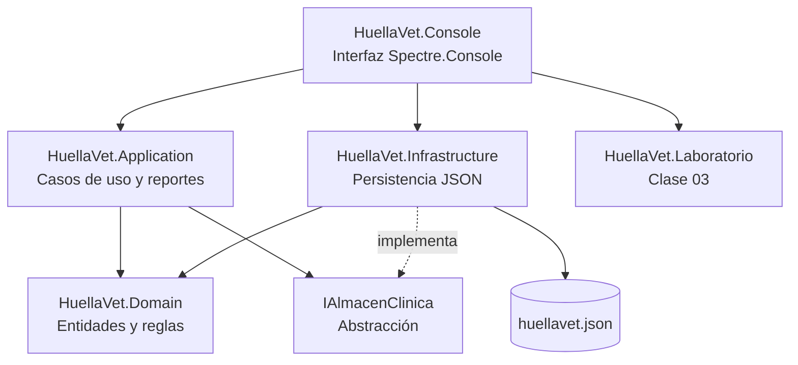

# 🐾 HuellaVet

**Sistema de gestión clínica veterinaria**  
Avance del proyecto final · Programación Orientada a Objetos (FI-134)


> «Cuidamos cada huella.»

HuellaVet es una clínica veterinaria ficticia que necesita ordenar su operación: dueños, mascotas, expedientes, agenda, personal, servicios, facturación e inventario. El proyecto transforma ese problema en un sistema por capas, con un dominio rico en objetos y una interfaz de consola cuidada.

Este repositorio corresponde al **avance del proyecto final** y también incluye, en un módulo aparte, la **solución exacta de la actividad de la Clase 03**: herencia, polimorfismo y sobrecarga.

---

## ¿Qué ya funciona?

| Módulo | Funcionalidades |
|---|---|
| **Dashboard** | Pacientes, citas del día, ingresos del mes, stock bajo, próximas vacunas. |
| **Clientes y mascotas** | Registro, búsqueda, expediente clínico, historial de citas y facturas. |
| **Agenda** | Programar, confirmar, iniciar atención, atender, cancelar y marcar inasistencia. |
| **Facturación** | Factura desde una cita atendida, descuentos, IVA, métodos de pago y puntos de fidelidad. |
| **Servicios** | Catálogo y simulación de precios según especie, peso, edad, riesgo y tipo de corte. |
| **Personal** | Nómina calculada con reglas distintas por cargo. |
| **Reportes** | Ingresos por servicio, pacientes por especie, servicios más solicitados, vacunas próximas e ingresos mensuales. |
| **Inventario** | Stock, mínimos, reposición y alertas. |
| **Laboratorio Clase 03** | `SeleccionFutbol`, `Forma`, sobrecarga y explicación aplicada al proyecto. |
| **Persistencia** | JSON local con guardado atómico; interfaz lista para sustituirse por SQL Server. |

---

## Requisito de la Clase 03

El profesor pidió desarrollar en C# la herencia y el polimorfismo de dos ilustraciones. Están implementados **con los nombres y miembros exactos** en `src/HuellaVet.Laboratorio/Clase03/`:

| Ilustración | Clases | Archivo |
|---|---|---|
| Herencia | `SeleccionFutbol` → `Futbolista`, `Entrenador`, `Masajista` | `SeleccionFutbol.cs` |
| Polimorfismo | `Forma` → `Circulo`, `Rectangulo`, `Cuadrado` | `Formas.cs` |
| Sobrecarga | `CalculadoraPrecios` con 4 variantes de `Calcular` | `CalculadoraPrecios.cs` |

Para verlo en ejecución:

```powershell
dotnet run --project src/HuellaVet.Console -- --demo
```

O dentro del menú: **Laboratorio POO (Clase 03)**.

---

## Demo rápida

```text
  _   _                  _   _          __     __         _
 | | | |  _   _    ___  | | | |   __ _  \ \   / /   ___  | |_
 | |_| | | | | |  / _ \ | | | |  / _` |  \ \ / /   / _ \ | __|
 |  _  | | |_| | |  __/ | | | | | (_| |   \ V /   |  __/ | |_
 |_| |_|  \__,_|  \___| |_| |_|  \__,_|    \_/     \___|  \__|

Cuidamos cada huella. · Sistema de gestión clínica veterinaria
```

Salida completa de la demostración: [`docs/capturas/demo.txt`](docs/capturas/demo.txt).

---

## Arquitectura



| Proyecto | Responsabilidad |
|---|---|
| `HuellaVet.Domain` | Entidades, jerarquías, reglas y excepciones de negocio. No depende de nadie. |
| `HuellaVet.Application` | Casos de uso, validaciones, facturación y reportes. Depende del dominio. |
| `HuellaVet.Infrastructure` | Implementación JSON y almacén en memoria. Implementa `IAlmacenClinica`. |
| `HuellaVet.Console` | Interfaz de usuario, menús, tablas y flujos guiados. |
| `HuellaVet.Laboratorio` | Clases exactas de la Clase 03 y guiones de demostración. |
| `HuellaVet.Tests` | 32 pruebas automatizadas con xUnit. |

---

## Estructura del repositorio

```text
HuellaVet/
├── src/
│   ├── HuellaVet.Domain/
│   │   ├── Personas/          Persona, Cliente, Empleado y cargos
│   │   ├── Mascotas/          Mascota, Perro, Gato, Ave, Conejo
│   │   ├── Servicios/         ServicioVeterinario y cinco servicios
│   │   ├── Citas/             Cita y EstadoCita
│   │   ├── Facturacion/       Factura, DetalleFactura, MetodoPago
│   │   ├── Inventario/        Producto y CategoriaProducto
│   │   └── ClinicaData.cs     Agregado raíz persistido
│   ├── HuellaVet.Application/
│   │   ├── Services/          ClinicaService, FacturacionService, ReporteService
│   │   ├── Dtos/              ExpedienteMascota y reportes
│   │   └── Abstractions/      IAlmacenClinica
│   ├── HuellaVet.Infrastructure/
│   │   └── Persistencia/      JsonAlmacenClinica, AlmacenMemoria, DatosDemo
│   ├── HuellaVet.Laboratorio/
│   │   └── Clase03/           SeleccionFutbol, Formas, CalculadoraPrecios
│   └── HuellaVet.Console/
│       ├── Pages/             Dashboard, clientes, agenda, facturación...
│       ├── MenuPrincipal.cs
│       ├── DemoRunner.cs
│       └── UI.cs
├── tests/HuellaVet.Tests/
├── docs/
│   ├── AVANCE.md              Documento principal de entrega
│   ├── DIAGRAMA_CLASES.md     Diagramas Mermaid
│   ├── ARQUITECTURA.md        Decisiones de diseño
│   ├── CLASE_03.md            Mapeo exacto de la actividad
│   ├── GUION_DEFENSA.md       Guion de exposición y preguntas
│   └── RUBRICA.md             Checklist de requisitos
├── .github/workflows/ci.yml
└── HuellaVet.sln
```

---

## Cómo ejecutar

Requisitos: [.NET SDK 10](https://dotnet.microsoft.com/) y Windows, Linux o macOS.

```powershell
# 1. Restaurar y compilar
dotnet restore
dotnet build

# 2. Demostración automática (sin interacción)
dotnet run --project src/HuellaVet.Console -- --demo

# 3. Aplicación interactiva
dotnet run --project src/HuellaVet.Console

# 4. Reiniciar los datos de ejemplo
dotnet run --project src/HuellaVet.Console -- --reset

# 5. Usar otro archivo de datos
dotnet run --project src/HuellaVet.Console -- --data "C:\ruta\huellavet.json"
```

La primera ejecución crea datos de demostración en:

```text
%LOCALAPPDATA%\HuellaVet\huellavet.json
```

---

## Pruebas

```powershell
dotnet test
```

Resultado actual:

```text
Correctas! - Con error: 0, Superado: 32, Omitido: 0, Total: 32
```

Las pruebas cubren:

- Herencia, polimorfismo y sobrecarga de la Clase 03.
- Cálculo de facturas, descuentos e IVA.
- Reglas de agenda, choques de horario y transiciones de estado.
- Facturación de citas atendidas y puntos de fidelidad.
- Reportes y persistencia JSON con tipos derivados.

---

## Documentación de la entrega

- **[Avance del proyecto](docs/AVANCE.md)** — documento académico con problema, objetivos, marco teórico, diseño, pruebas y conclusiones.
- **[Diagramas de clases](docs/DIAGRAMA_CLASES.md)** — jerarquías y relaciones en Mermaid.
- **[Arquitectura](docs/ARQUITECTURA.md)** — capas, dependencias y decisiones.
- **[Clase 03](docs/CLASE_03.md)** — correspondencia exacta con las ilustraciones del profesor.
- **[Guion de defensa](docs/GUION_DEFENSA.md)** — recorrido de 7 minutos y preguntas probables.
- **[Rúbrica](docs/RUBRICA.md)** — checklist de lo implementado y lo planificado.

---

## Estado y siguiente fase

| Fase | Estado |
|---|---|
| Dominio, POO, herencia, polimorfismo y sobrecarga | ✅ Implementado |
| Casos de uso, facturación, reportes y persistencia JSON | ✅ Implementado |
| Pruebas automatizadas y CI | ✅ Implementado |
| Interfaz gráfica (WinForms/WPF o web) | 🔜 Siguiente entrega |
| SQL Server + ADO.NET | 🔜 Unidad 3 |
| CRUD completo de todas las entidades | 🔜 Unidad 5 |
| Autenticación y roles | 🔜 Futuro |

> El avance prioriza el **diseño orientado a objetos y la lógica de negocio**. La interfaz de consola permite demostrar todos los flujos sin depender de una base de datos o de un entorno gráfico.

---

## Autor

**Yeskel Sandoval**  
Ingeniería en Sistemas y Computación  
Programación Orientada a Objetos · III Cuatrimestre 2026  
Docente: Ing. Gustavo Acevedo Martínez

Proyecto académico de uso educativo.
