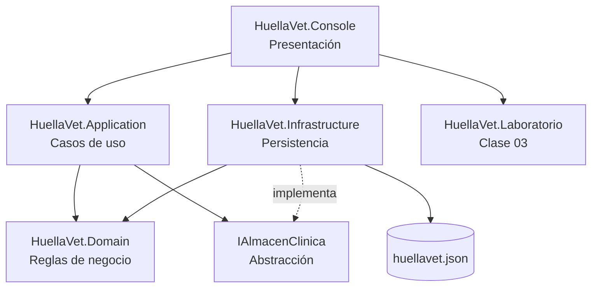

# Arquitectura de HuellaVet

## 1. Vista general

HuellaVet sigue una arquitectura por capas con dependencias dirigidas hacia el dominio.



| Capa | Proyecto | Puede depender de |
|---|---|---|
| Dominio | `HuellaVet.Domain` | Nada |
| Aplicación | `HuellaVet.Application` | `Domain` |
| Infraestructura | `HuellaVet.Infrastructure` | `Application`, `Domain` |
| Presentación | `HuellaVet.Console` | `Application`, `Infrastructure`, `Laboratorio` |
| Laboratorio | `HuellaVet.Laboratorio` | Nada |

La regla importante es que **el dominio no conoce la consola, el JSON ni la base de datos**. Eso permite cambiar la interfaz o la persistencia sin reescribir las reglas del negocio.

---

## 2. ¿Por qué una interfaz de almacenamiento?

```csharp
public interface IAlmacenClinica
{
    ClinicaData Datos { get; }
    void Guardar();
    void Restablecer(ClinicaData datos);
}
```

La aplicación trabaja contra `IAlmacenClinica`. Hoy existen dos implementaciones:

- `JsonAlmacenClinica`: guarda un archivo local con escritura atómica.
- `AlmacenMemoria`: no escribe archivos; se usa en pruebas y demostraciones.

En la siguiente fase se puede crear `SqlAlmacenClinica` o dividir la interfaz en repositorios por entidad (`IClienteRepository`, `ICitaRepository`, etc.) sin tocar `ClinicaService` ni `FacturacionService`.

---

## 3. Flujo de un caso de uso

### Programar una cita

```text
UI (AgendaPage)
  → ClinicaService.ProgramarCita(...)
      → valida cliente, mascota, veterinario y servicio
      → valida fecha futura
      → detecta choque de horario (30 minutos)
      → crea Cita
      → _almacen.Guardar()
  → JSON actualizado
```

### Atender y facturar

```text
UI (AgendaPage)
  → ClinicaService.IniciarAtencion(citaId)
  → ClinicaService.AtenderCita(citaId, diagnóstico, peso, observaciones)
      → Cita.Atender(...) cambia el estado a Atendida
      → actualiza peso y última visita de la mascota
  → FacturacionService.GenerarFacturaParaCita(citaId, pago, descuento)
      → verifica que la cita esté atendida
      → evita factura duplicada
      → llama servicio.CalcularPrecio(mascota)   ← polimorfismo
      → crea Factura, aplica descuento e IVA
      → registra pago y puntos de fidelidad
      → _almacen.Guardar()
```

---

## 4. Decisiones de diseño

### 4.1 El dominio no usa `Console`

Las entidades no imprimen mensajes ni leen teclado. Devuelven datos o lanzan `ReglaNegocioException`. La consola decide cómo mostrarlos.

### 4.2 Las reglas viven en los objetos

- `Cita` controla sus transiciones: no se puede atender una cita cancelada.
- `Factura` calcula su total y no permite pagar dos veces.
- `Producto` valida el stock antes de descontar.
- `ServicioVeterinario` decide su precio según la mascota.

Esto evita que la interfaz tenga `if` gigantes y permite probar las reglas sin abrir la aplicación.

### 4.3 Polimorfismo en lugar de condicionales

En lugar de:

```csharp
if (servicio is Cirugia) { ... }
else if (servicio is Vacunacion) { ... }
```

se usa:

```csharp
var precio = servicio.CalcularPrecio(mascota);
```

Cada clase concreta encapsula su propia fórmula. Agregar un servicio nuevo no obliga a modificar el código que factura.

### 4.4 Persistencia JSON en el avance

Ventajas para esta etapa:

- No requiere instalar SQL Server.
- Permite demostrar el sistema en cualquier computadora.
- El archivo es legible y fácil de respaldar.
- La interfaz `IAlmacenClinica` deja abierta la migración.

Limitaciones:

- No hay concurrencia multiusuario.
- No hay transacciones.
- No reemplaza una base de datos relacional.

La Unidad 3 del curso trabaja acceso a datos; ahí se incorporará SQL Server con ADO.NET.

### 4.5 Pruebas con almacén en memoria

`AlmacenMemoria` permite probar los servicios sin archivos temporales ni base de datos. Las pruebas son rápidas y deterministas. La persistencia JSON tiene su propia prueba de ida y vuelta.

---

## 5. Manejo de errores

Los errores esperados usan `ReglaNegocioException`:

- Documento duplicado.
- Fecha pasada.
- Choque de horario.
- Servicio inactivo.
- Cita no atendida.
- Factura duplicada.
- Stock insuficiente.

La interfaz captura esa excepción y muestra un mensaje comprensible. Los errores inesperados se muestran con un mensaje genérico para no romper la aplicación.

---

## 6. Estructura de datos

`ClinicaData` es el agregado raíz que se serializa:

```csharp
public sealed class ClinicaData
{
    public List<Cliente> Clientes { get; set; } = [];
    public List<Empleado> Empleados { get; set; } = [];
    public List<Mascota> Mascotas { get; set; } = [];
    public List<ServicioVeterinario> Servicios { get; set; } = [];
    public List<Cita> Citas { get; set; } = [];
    public List<Factura> Facturas { get; set; } = [];
    public List<Producto> Productos { get; set; } = [];
}
```

Las relaciones se guardan por identificadores (`ClienteId`, `MascotaId`, `ServicioId`) para evitar ciclos de serialización. Los servicios resuelven los nombres cuando la interfaz los necesita.

### Polimorfismo en JSON

`Empleado`, `Mascota` y `ServicioVeterinario` usan `[JsonPolymorphic]` y `[JsonDerivedType]`. El archivo guarda un discriminador `$tipo`:

```json
{
  "$tipo": "perro",
  "Nombre": "Rocco",
  "Raza": "Labrador",
  "PesoKg": 28
}
```

Así se recuperan `Perro`, `Gato`, `Veterinario` o `Cirugia` sin perder el tipo concreto.

---

## 7. Ruta hacia la siguiente entrega

1. **Interfaz gráfica:** WinForms/WPF o web. La lógica ya está separada; solo se reemplazan las páginas de consola.
2. **SQL Server:** crear la base `HuellaVet`, tablas y procedimientos; implementar repositorios ADO.NET.
3. **CRUD completo:** altas, bajas, cambios y consultas de todas las entidades.
4. **Seguridad:** inicio de sesión, roles (administrador, veterinario, recepción) y auditoría.
5. **Reportes exportables:** PDF/Excel y gráficos.

---

## 8. Conclusión

La arquitectura permite que el avance sea pequeño pero extensible: el dominio ya contiene las reglas, la aplicación ya orquesta los casos de uso y la infraestructura se puede cambiar. Esa separación es la base para las unidades de interfaz, acceso a datos y programación por capas.
