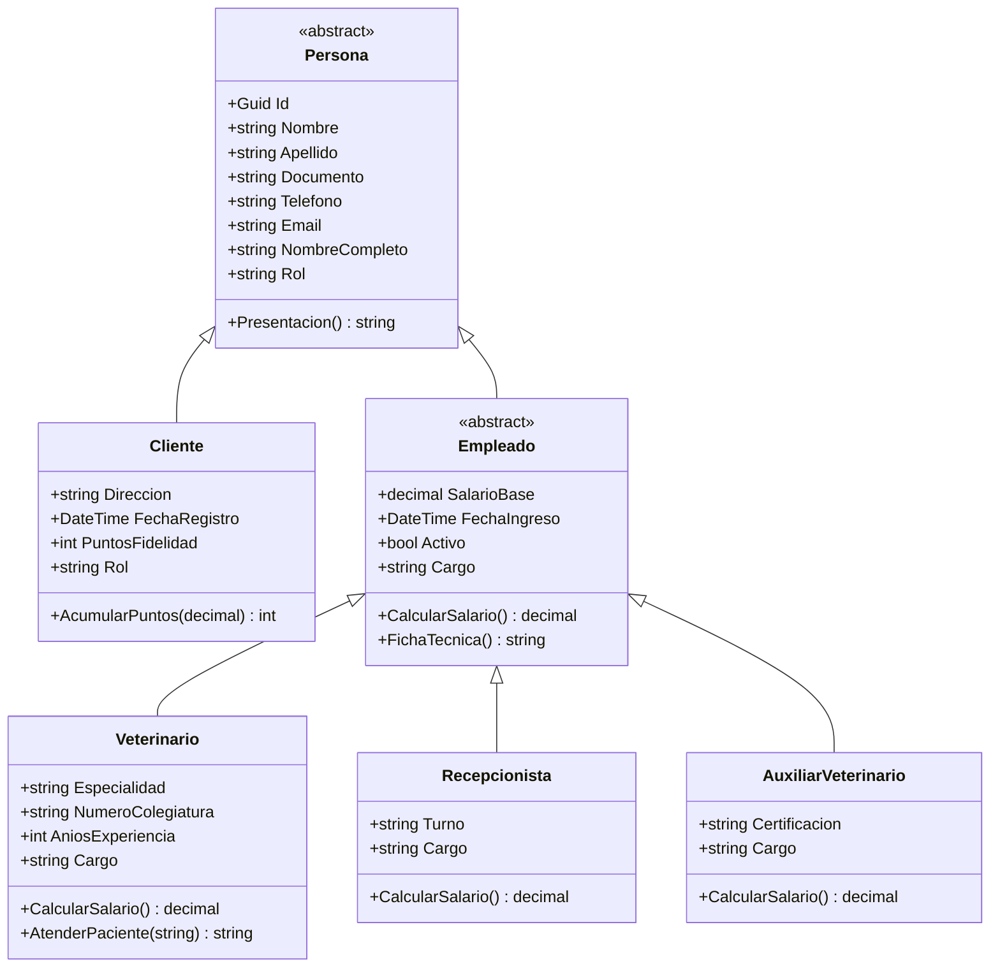
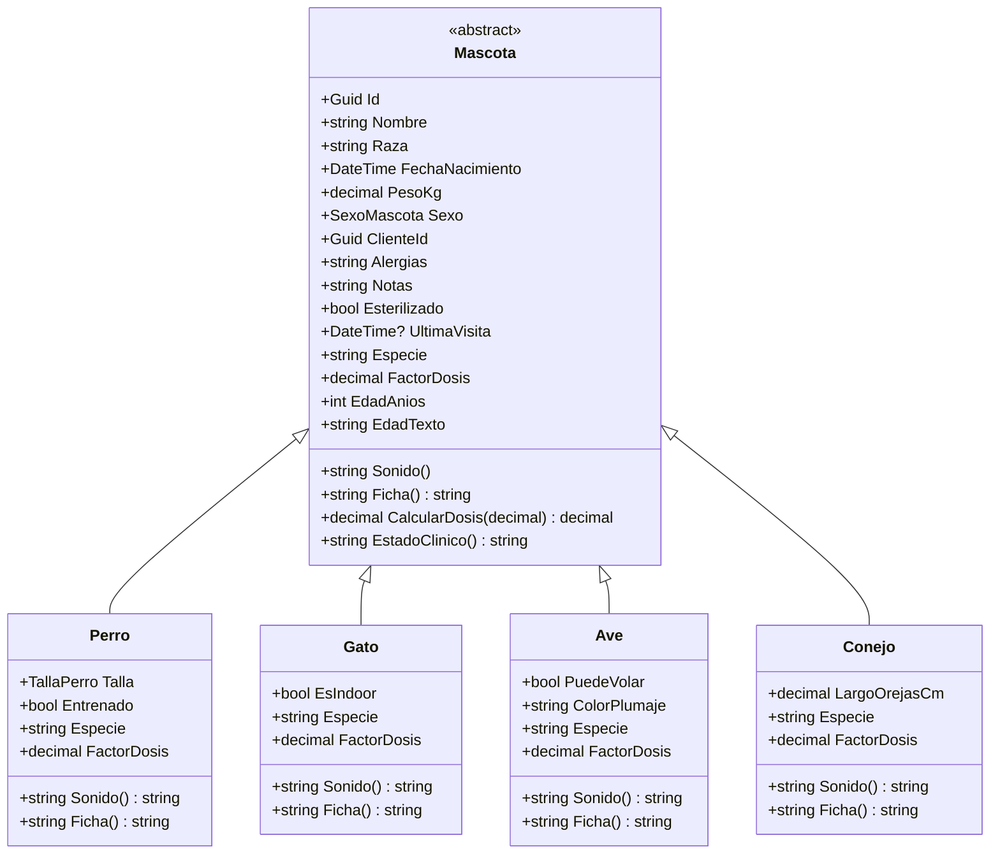
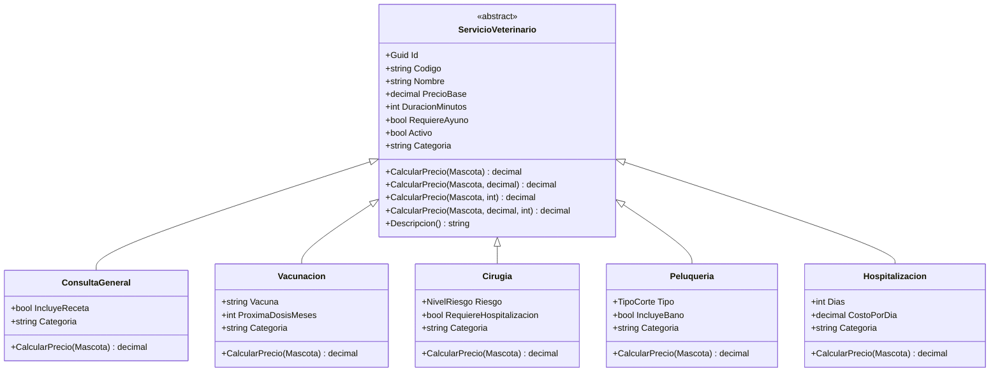
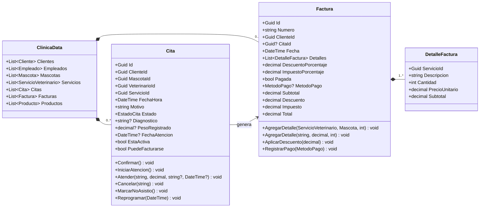
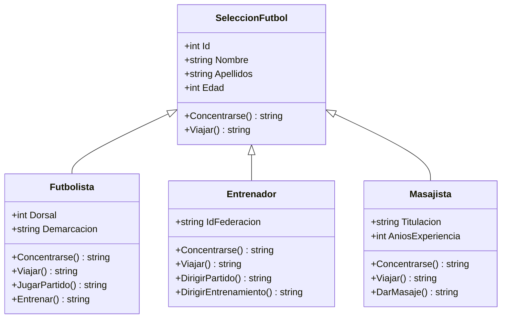
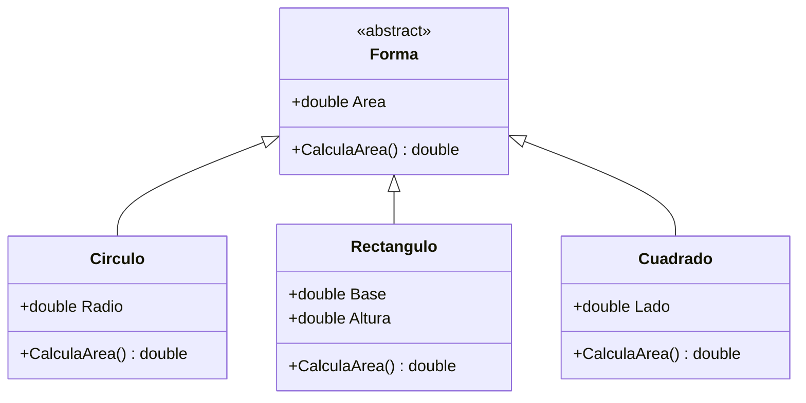

# Diagramas de clases

Los diagramas usan [Mermaid](https://mermaid.js.org/). GitHub y Visual Studio Code los renderizan directamente.

---

## 1. Personas

**Conceptos:** herencia, clase abstracta, propiedad abstracta (`Rol`), método virtual (`CalcularSalario`) y polimorfismo.

---

## 2. Pacientes

**Conceptos:** propiedad abstracta (`Especie`, `FactorDosis`), método abstracto (`Sonido`), método virtual (`Ficha`) y polimorfismo en `CalcularDosis`.

---

## 3. Servicios

**Conceptos:** método abstracto (`CalcularPrecio`), sobrecarga (cuatro versiones) y polimorfismo puro: una lista de `ServicioVeterinario` calcula precios distintos sin preguntar el tipo.

---

## 4. Citas y facturación

**Conceptos:** encapsulación del estado (`Estado` solo cambia con métodos), composición (`Factura` contiene detalles), cálculos derivados (`Total` no se asigna) y sobrecarga (`AgregarDetalle`).

---

## 5. Laboratorio Clase 03 · Herencia

---

## 6. Laboratorio Clase 03 · Polimorfismo

> `Cuadrado` hereda directamente de `Forma`, tal como aparece en la ilustración del profesor. No se hizo heredar de `Rectangulo` para respetar el diseño solicitado.
